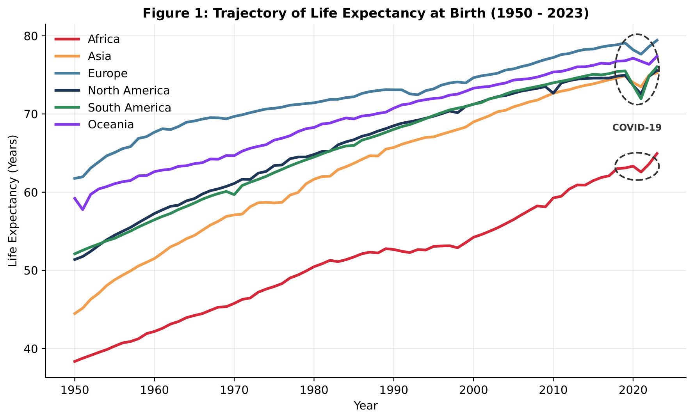
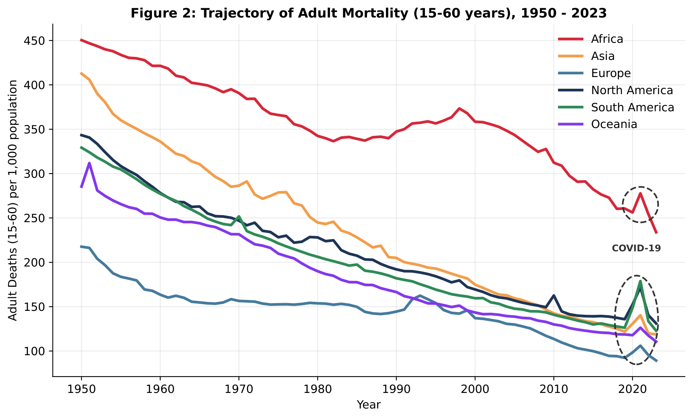
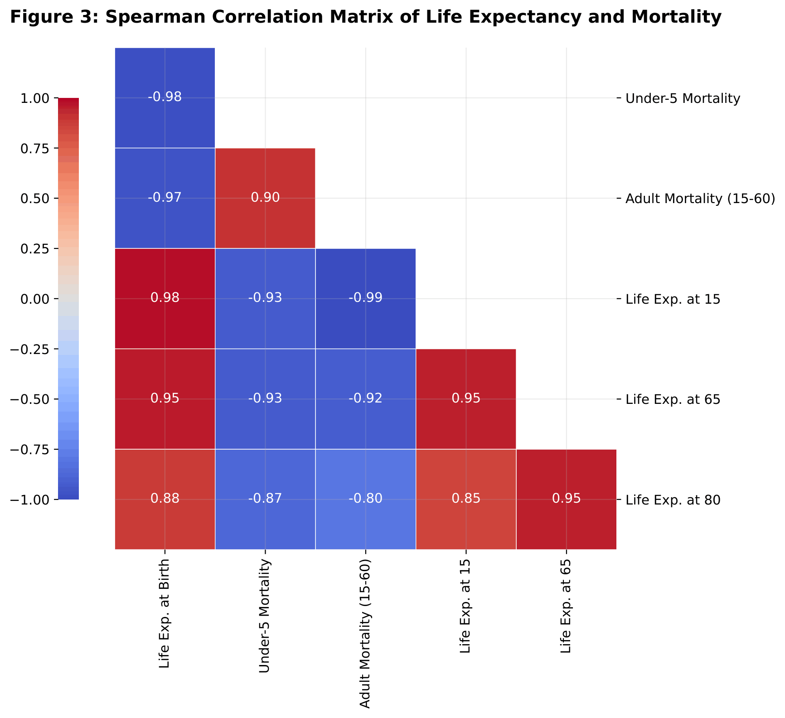
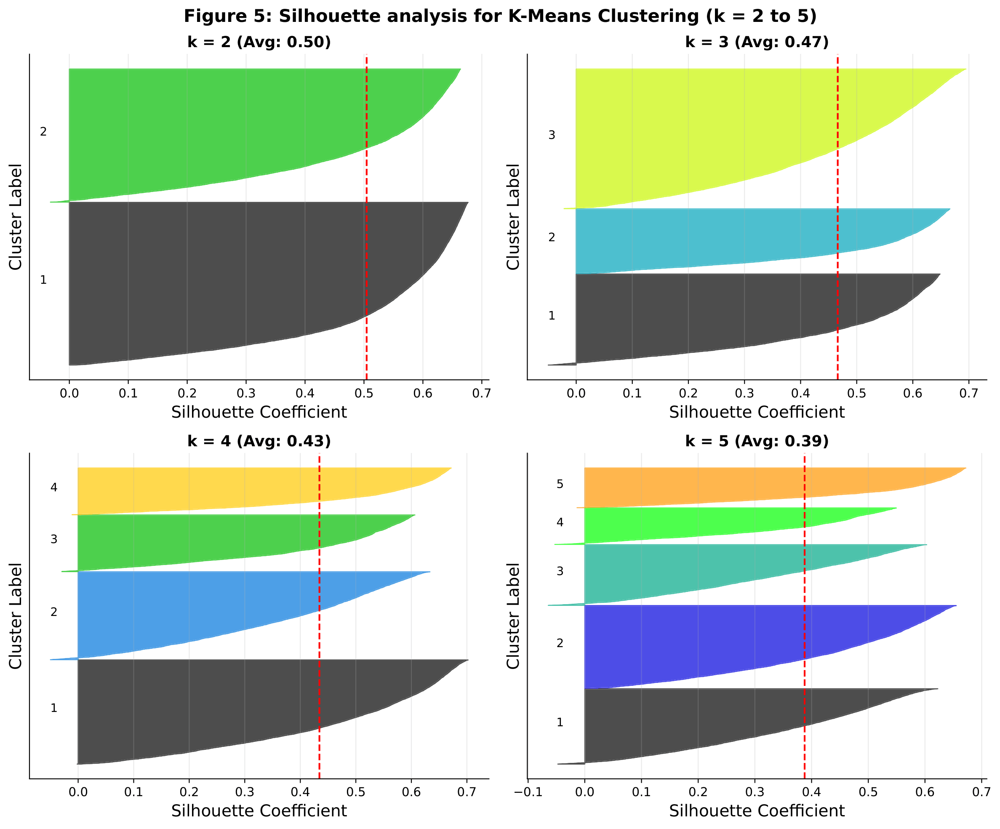
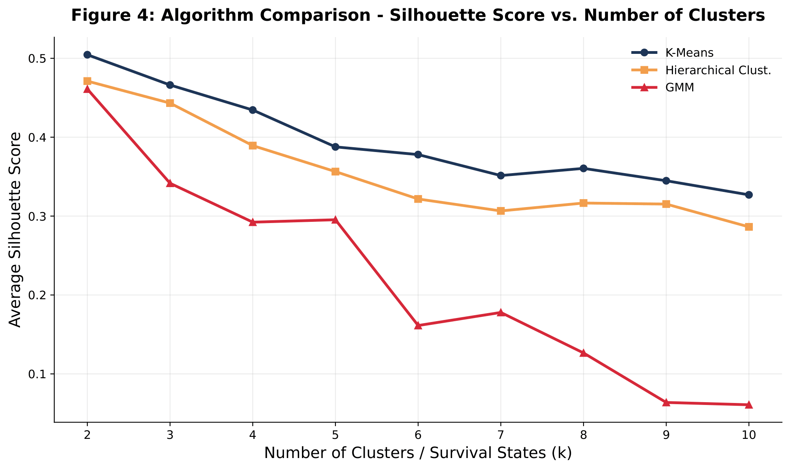
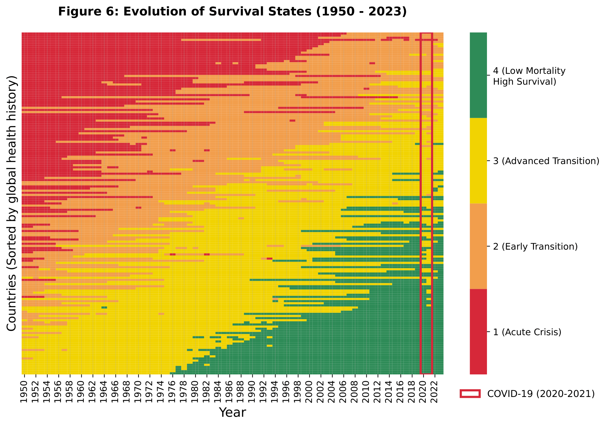
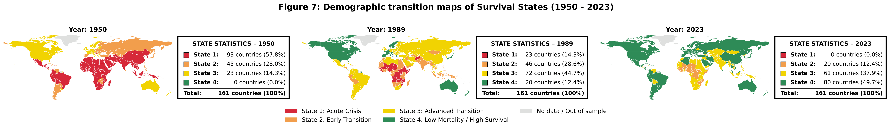
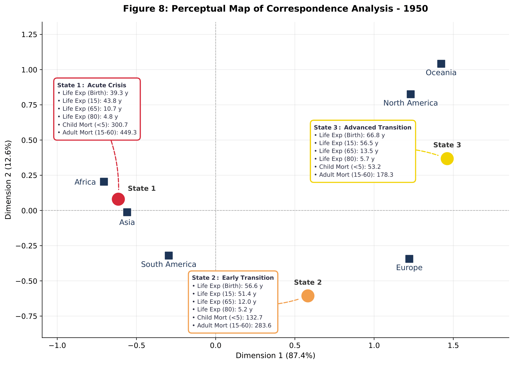
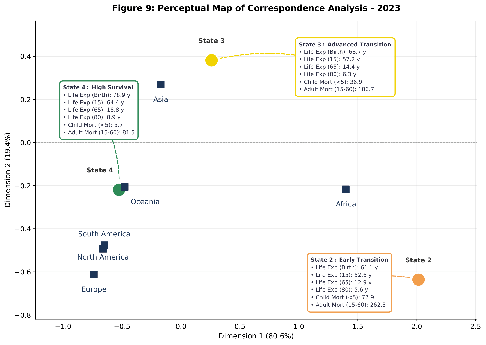

```{r setup}
library(ggplot2)
library(dplyr)
library(tidyr)
library(scales)

# ---- Paleta (slides escuros) ----
vd <- c(
  fundo    = "#0B2545",
  grade    = "#1E3A5F",
  texto    = "#DCE8F3",
  turquesa = "#2EC4C4",
  coral    = "#FF6B5E",
  areia    = "#E9B872",
  azul     = "#8EC5F0",
  lilas    = "#C9A7FF"
)
cores_paises <- c(
  "Japão"   = unname(vd["turquesa"]),
  "Brasil"  = unname(vd["coral"]),
  "EUA"     = unname(vd["areia"]),
  "Índia"   = unname(vd["azul"]),
  "Nigéria" = unname(vd["lilas"])
)

theme_vd_dark <- function(base_size = 15) {
  theme_minimal(base_size = base_size) +
    theme(
      plot.background   = element_rect(fill = vd["fundo"], color = NA),
      panel.background  = element_rect(fill = vd["fundo"], color = NA),
      panel.grid.major  = element_line(color = vd["grade"], linewidth = 0.4),
      panel.grid.minor  = element_blank(),
      text              = element_text(color = vd["texto"]),
      axis.text         = element_text(color = vd["texto"]),
      axis.title        = element_text(color = vd["texto"]),
      plot.title        = element_text(face = "bold", color = "#FFFFFF", size = rel(1.1)),
      plot.subtitle     = element_text(color = vd["azul"]),
      plot.caption      = element_text(color = "#7F97B0", size = rel(0.65)),
      legend.position   = "bottom",
      legend.title      = element_blank(),
      legend.text       = element_text(color = vd["texto"]),
      plot.margin       = margin(8, 12, 8, 8)
    )
}

# ---- Dados SIMULADOS (substituir por UN WPP / HMD) ----
sat <- function(t, ini, fim, k) ini + (fim - ini) * (1 - exp(-k * t)) / (1 - exp(-k * 70))

paises <- tibble::tribble(
  ~pais,     ~e0_ini, ~e0_fim, ~k,    ~logit_ini, ~ritmo, ~e80_ini, ~e80_fim,
  "Japão",     62,      85,    0.030,  -2.2,       0.045,   5.5,      11.5,
  "Brasil",    51,      75,    0.035,  -3.6,       0.040,   5.8,       9.0,
  "EUA",       68,      79,    0.030,  -2.0,       0.030,   7.0,       9.0,
  "Índia",     36,      70,    0.040,  -4.4,       0.040,   5.0,       7.5,
  "Nigéria",   37,      53,    0.025,  -4.8,       0.022,   4.5,       5.8
)

dados <- paises |>
  tidyr::crossing(ano = seq(1950, 2020, 5)) |>
  mutate(
    t   = ano - 1950,
    e0  = sat(t, e0_ini, e0_fim, k),
    p80 = plogis(logit_ini + ritmo * t),
    e80 = sat(t, e80_ini, e80_fim, k)
  ) |>
  mutate(pais = factor(pais, levels = names(cores_paises)))

legenda_sim <- "Dados simulados para fins ilustrativos."
```

## Introduction {#slide-transicao .slide-escuro background-color="#0B2545"}

:::: {.columns .divisoria}

::: {.column width="45%"}

{width="100%" style="margin-bottom: 80px;"}

{width="100%"}

:::

::: {.column width="45%"}

### 

::: {.column width="56%"}

<div style="font-size: 0.72em; line-height: 1.4; text-align: justify;">

::: {style="display: flex; gap: 30px;"}

::: {style="flex: 1;"}
**Motivation:** We decided to focus on the dynamics of mortality and longevity — among the extensive data in WPP 2024 — because assessing human progress solely by average life expectancy conceals severe disparities in age at death and the shift in risk from childhood to adulthood and old age **(Aburto, 2020; Araújo, 2026)**.
:::

::: {style="flex: 1;"}
**Scope:** Our database exclusively covers sovereign countries with a population $\ge 1$ million in 2023 (161 countries, following the criterion of Araújo, 2026) and complete historical series between 1950 and 2023 (11,914 records), avoiding micro-population distortions and regional aggregates.
:::

:::

<div style="margin-top: 12px;">
However, as the charts by continent (Figures 1 and 2) illustrate, the demographic transition is geographically uneven. While Asia and the Americas  have converged toward levels similar to those seen in Europe and Oceania, Africa continues to face a critical gap, reaching up to 15 years in life expectancy. This is compounded by a reversal in adult mortality (for the 15–60 age range) that was observed during the 1990s. Such disparities highlight that premature mortality during the productive years and asymmetric aging remain core social and economic challenges. Moreover, the stability of these historical gains proved fragile in the face of recent exogenous shocks: data from 2020 and 2021 capture the drastic disruption caused by the COVID-19 pandemic, manifested in an abrupt decline in life expectancy and a sharp spike in adult mortality—impacts that <u> **were particularly severe across the Americas** </u>.
</div>

</div>

:::

:::

::::

## Data and Metodology {#slide-dados .slide-escuro background-color="#0B2545"}

:::: {.columns .divisoria}

::: {.column width="50%"}

```{r}
library(dplyr)
library(knitr)

# 1. Criar um data.frame com o código HTML das imagens
tabela_imagens <- data.frame(
  Figure_3 = c(''),
  Figure_5  = c('')
)

# 2. Exibir a tabela permitindo a leitura de código HTML (escape = FALSE)
kable(tabela_imagens, format = "html", escape = FALSE, col.names = NULL)
```

{width="100%" style="margin-left: 10px; margin-top: 50px; display: block;"}

:::

::: {.column width="50%"}

###

::: {.column width="50%"}

<div style="font-size: 0.51em; line-height: 1.4; text-align: justify;">

::: {style="display: flex; gap: 10px;"}

::: {style="flex: 1.5;"}
On the left, you can observe the six age indicators used in our modeling and their Spearman Correlation Matrix (Figure 3). While Life Expectancy at Birth exhibits a nearly perfect negative correlation with Infant Mortality ($\rho = -0.98$) and Adult Mortality ($\rho = -0.97$), the strength of these relationships significantly decreases to $-0.87$ and $-0.80$, respectively, when compared to Life Expectancy at Age 80. This nonlinear attenuation highlights a fundamental divergence across life stages: progress in early-life survival does not automatically translate into proportional gains at advanced ages. These results strongly corroborate the argument by **Aburto (2020)** that adult and elderly mortality dynamics follow distinct epidemiological pathways. Consequently, this multi-dimensional structural heterogeneity fully justifies the application of a multivariate clustering approach capable of capturing the complete mortality profile of each country rather than relying on isolated metrics.
:::

::: {style="flex: 1.5;"}
Given this necessity, Figure 4 presents a comparison among three clustering algorithms: **<u>K-Means, Hierarchical, and GMM</u>**, considering values of $k$ between 2 and 10 across the 11,914 standardized country-year observations. **<u>The results indicate that K-Means presents the best silhouette scores across all evaluated scenarios</u>**. As highlighted by **Géron (2026)**, silhouette analysis makes it possible to evaluate internal cohesion and separation between clusters, being especially useful for comparing different configurations of the number of clusters. By deepening this analysis in Figure 5, considering configurations of $k$ between 2 and 5, we observe that the solution with $k = 4$, whose average silhouette coefficient is $0.43$, presents good cohesion among groups and practically no observations with negative values. In contrast, the configuration with $k = 5$ shows a reduction in the average coefficient to $0.39$, accompanied by the reappearance of negative values in Cluster 1, indicating greater difficulty in separating certain observations.
:::

:::

<div style="margin-top: 12px;">
Although the configuration with $k = 2$ presents the highest average silhouette coefficient ($0.50$), we chose to reject it due to its interpretive and demographic limitations. As discussed by **Araújo (2026)**, a binary classification tends to reduce global heterogeneity to the distinction between high and low mortality countries, concealing intermediate stages of the demographic transition. In this sense, **<u>the choice of $k = 4$ Mortality States represents a balance between statistical quality and demographic interpretability</u>**, allowing us to identify four distinct regimes of the global demographic transition—ranging from Acute Crisis contexts to Low Mortality situations—while preserving the structural differences that characterize the mortality and longevity trajectories of countries.
</div>

</div>

:::

:::

::::


## Results and Discussions {#slide-metodologia .slide-escuro background-color="#0B2545"}

:::: {.columns .divisoria}

::: {.column width="50%"}

{width="100%"}

{width="95%"}

:::

::: {.column width="50%"}

###

::: {.column width="50%"}

<div style="font-size: 0.60em; line-height: 1.4; text-align: justify;">

::: {style="display: flex; gap: 20px;"}

::: {style="flex: 1.5;"}
The four states defined in the previous slide allow for a continuous tracking of how survival patterns across the 161 locations transformed between 1950 and 2023. In the chart, each horizontal line represents the historical trajectory of a country or territory ordered by its overall health history, and the gradual transition from red (State 1) and orange (State 2) to yellow (State 3) and green (State 4) highlights a widespread global gain in longevity. Notably, in 1950, no location had reached State 4, which only begins to emerge consistently from the mid-1970s onward. However, the timing of entry and duration of stay in each regime vary profoundly: while locations at the bottom of the chart achieve a low-mortality profile early and stabilize within it, the upper bands spend decades trapped in States 1 and 2. Furthermore, the temporary return of several lines to higher-mortality colors—both in the 1990s and in the early 2020s—demonstrates that demographic progress is neither linear nor irreversible, remaining vulnerable to stagnation and reversals in the face of health and socioeconomic crises. In particular, <u>**the sharp contraction observed in the early 2020s reflects the profound global impact of the COVID-19 pandemic**</u>, which caused an unprecedented drop in life expectancy worldwide, momentarily erasing decades of continuous gains in survival across both high- and low-income populations.
:::

::: {style="flex: 1.5;"}
The maps from 1950, 1989, and 2023 map this transformation spatially and reveal how the geography of survival was reshaped over seven decades. In 1950, State 1 (acute crisis, in red) predominated almost continuously across Africa, Asia, and much of Latin America, while State 3 (advanced transition, in yellow) was restricted to North America, Western Europe, and Oceania. By 1989, a decisive intermediate leap is observable: the advanced transition came to cover nearly all of Latin America, Eastern Europe, and parts of Asia, while State 4 (low mortality, in green) consolidated in the United States, Canada, Western Europe, Japan, Australia, and New Zealand. By 2023, State 1 completely disappears from the global map, and the most favorable profile (State 4) expands into new regions, including most of South America—such as Brazil—and East Asia, such as China. However, the concentration of countries still stuck in State 2 (in orange) in Sub-Saharan Africa proves that, despite the eradication of the most extreme level of mortality, gains in survival remain geographically uneven.
:::

:::

</div>

:::

:::

::::


## Conclusion {#slide-discussions .slide-escuro background-color="#0B2545"}

:::: {.columns .divisoria}

::: {.column width="50%"}

{width="100%" style="margin-bottom: 20px;"}

{width="100%"}

:::

::: {.column width="50%"}

### 

::: {.column width="56%"}

<div style="font-size: 0.62em; line-height: 1.4; text-align: justify;">

::: {style="display: flex; gap: 30px;"}

::: {style="flex: 1;"}
The first chart synthesizes how mortality states are distributed across continents at the beginning of the series, considering the population weight of the analyzed locations. Africa and Asia show a strong concentration in state 1, while North America and Oceania stand out for the relative presence of state 3. Europe combines the states of early and advanced transition, and South America gathers a larger population in state 1, alongside the presence of state 2. This configuration deepens the reading of the geographical maps: the starting points of the transition differed across regions.
:::

::: {style="flex: 1;"}
In the 2023 perceptual chart, <u> **the disappearance of state 1 and the presence of state 4**</u> (low mortality) reshape regional groupings. Europe (98.4% of the population in state 4), North America (91.6%), South America (90.6%), and Oceania (75.3%) converge in the left quadrant alongside state 4. Asia positions itself between the green and yellow circles by dividing its population almost equally between state 3 (51.7%) and state 4 (48.3%). On the far right, state 2 (early transition) remains exclusively associated with Africa: although 53.6% of the African population is already in state 3, 42.4% still lives in state 2, a profile already surpassed by all other continents.
:::

:::

<div style="margin-top: 12px;">


</div>

The sequential combination of statistical techniques, starting from Spearman's correlation, moving through K-Means clustering, and culminating in the analysis of temporal trajectories and population-weighted correspondence analysis, was decisive in looking beyond global longevity averages between 1950 and 2023 **(Artes, 2023)**. While multivariate clustering condensed six age indicators to highlight the extinction of the acute crisis state (state 1) and the broad expansion of the most favorable states (3 and 4), longitudinal and spatial monitoring showed that this progress is neither linear nor territorially homogeneous. Thus, <u>**modeling indicates that the arrival of a large part of the world at state 4 does not imply the absence of current problems, but rather a relative evolution compared to the severe levels of 1950**</u> , dividing the contemporary agenda between combating premature adult mortality (15–60 years) that still keeps part of Africa in the initial transition (state 2) and sustaining health and social security systems in regions that have achieved higher survival at advanced ages (state 4).

</div>

:::

:::

::::

## References {#slide-referencias .slide-referencias background-color="#1E2021"}

### Dataset

::: {.referencias}

- The given dataset: "WPP2024_Demographic_Indicators_Medium"

:::

### Reference materials

::: {.referencias}

- Aburto, J. M., Villavicencio, F., Basellini, U., Kjærgaard, S., & Vaupel, J. W. (2020). Dynamics of life expectancy and life span equality. *_Proceedings of the National Academy of Sciences_*, 117(10), 5250-5259. <https://doi.org/10.1073/pnas.1915884117>.
- Araújo, P. M., Basellini, U., Murphy, T. B., & Gormley, I. C. (2026). *_Characterising mortality dynamics across countries and time using a multi-stage clustering approach_*. arXiv. <https://doi.org/10.48550/arXiv.2609.17268>.
- Géron, A. (2022). *_Hands-On Machine Learning with Scikit-Learn, Keras, and TensorFlow_* (3rd ed.). O'Reilly Media.
- ARTES, Rinaldo. (2023). *_Métodos multivariados de análise estatística_*. Editora Blucher. <https://www.blucher.com.br/metodos-multivariados-de-analise-estatistica-9786555067026>.
:::

<div style="font-size: 0.50em; line-height: 1.4; text-align: justify;">

For more details access our project’s repo on GitHub: <https://github.com/CAIO-LIMA-37/Dataquest-VeroData>

The repo will be turned from private to public
after 30/10/2025 23:59(UTC-3).


